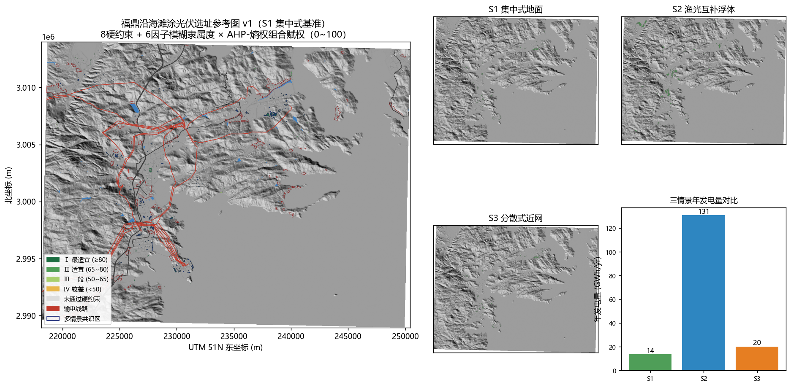

# 福鼎沿海滩涂光伏电站选址（8 硬约束 + 6 因子 AHP×熵权 + 三情景 + 产能估算）

> 《福鼎白茶新茶园选址》的方法论姊妹篇——**"山地适茶、沿海适光"**双选址系列：
> 同一套"否决性约束筛选 + 模糊隶属度连续建模 + AHP×熵权组合赋权 + 敏感性/多情景"内核，
> 决策要素完全不同：茶园看坡向与海拔，光伏看**并网距离、地类准入（滩涂 vs 耕地）与太阳辐射收益**。
>
> 📍 在线结果图库：<https://dingdjfjs-star.github.io/tidal-flat-pv-siting/>
> 交付文档：[技术路线.md](技术路线.md)（GeoScene Pro 操作线 + Python 复算线双口径）

## 核心结论（先说答案）

- **8 条否决性硬约束筛完，地面集中式仅剩 193 ha（0.2%）**——主控约束：地类准入（仅 2.3% 通过，研究区 42.9% 被 WorldCover 映射为水体/海面）、坡度（51.5%）、并网距离（47.1%）。
  **"地面集中式在福鼎沿海几乎没有空间"本身即是核心结论。**
- 三情景对比：**渔光互补浮体 9 片 / 161 ha ≈ 135 MW / 131 GWh，是唯一规模化路径**（与福建省海上光伏试点以渔光互补为主的政策现实吻合）；地面集中式仅存龙安街道一处 17 ha 裸地孤块（S=93.6）；多情景共识区 68 ha。
- 太阳几何数值积分产能模型自检：转换系数 f(0°)=1.000 / 南坡 5°=1.009 / 北坡 5°=0.986——南向微坡增益、北向损耗，符号与量级正确。



*左：S1 集中式基准适宜性图（山体阴影 + 四级适宜性 + 输电线路 + 多情景共识区描边）；右上三联：S1/S2/S3 三情景候选地块；右下：三情景年发电量对比（14 / 131 / 20 GWh）。*

## 方法链

### L1 否决性硬约束（8 条）

| # | 约束 | 阈值 |
|---|---|---|
| H1 | 坡度 | ≤8° |
| H2 | 地类准入 | WorldCover ∈ {灌木, 草地, 裸地, 滩涂湿地}（严禁耕地与沿海防护林） |
| H3 | 生态保护地 | 不在保护地内 |
| H4 | 建设冲突 | 距居民点用地/建筑 ≥150m，距村镇点 ≥300m |
| H5 | 道路双面 | 50m＜距道路 ≤2000m，且距高速 ≥200m（可达 + 眩光退距） |
| H6 | **并网条件** | 距输电线路 ≤3000m（本选题新增要素） |
| H7 | 涉水安全 | 距水系/水面 ≥50m，距水库 ≥300m |
| H8 | 高程下限 | ≥2m（风暴潮与天文大潮安全） |

### L2 六因子模糊隶属度 × AHP×熵权组合赋权（几何平均）

| 因子 | 组合权重 | （AHP｜熵权） |
|---|---|---|
| 地类现状 | **0.242** | .16｜.302 |
| 并网距离 | **0.219** | .28｜.142 |
| 坡度 | **0.197** | .18｜.178 |
| 居民点退距 | **0.196** | .10｜.316 |
| 道路可达 | 0.078 | .16｜.031 |
| 生态缓冲 | 0.068 | .12｜.031 |

熵权与 AHP 的显著分歧（居民点退距 0.316 对 0.10、道路 0.031 对 0.16）反映小可行域内隶属度方差的再分配；敏感性分析：全因子扰动 ±50% 时候选面积波动仅 −4.6%~+2.0%（小可行域阈值饱和效应），组合结果稳定。

### L3 三经营情景 + 产能估算

| 情景 | 调整 | 候选 | 装机潜力 | 年发电量 |
|---|---|---|---|---|
| S1 集中式地面（基准） | 如上 | **1 片 / 17 ha**（S=93.6） | 0.014 GW | 14 GWh |
| S2 渔光互补浮体 | 地类放宽至水面/滩涂，坡度因子取 1，地类权重提至 0.30 | **9 片 / 161 ha** | **0.135 GW** | **131 GWh** |
| S3 分散式近网 | 并网收紧至 1500m，规模门槛降至 5ha | 2 片 / 25 ha | 0.021 GW | 20 GWh |

**产能估算（太阳辐射建模，双口径互校）**：
- GeoScene Pro 侧：区域太阳辐射工具（Area Solar Radiation，含坡度坡向遮挡校正）生成年辐射量场，按候选地块分区统计；
- Python 复算侧：太阳几何数值积分——12 个月代表日 × 逐 0.2° 时角采样太阳矢量（赤纬 Cooper 公式）投影到地块平均坡度/坡向面，各向同性天空模型（直散分离 df=0.45、反照率 ρ=0.2）积分年 POA 得倾斜面转换系数 f；
- 年发电量 E = f × GHI_ref × η × PR × 面积（GHI_ref=1210 kWh/m²·yr 按 KT=0.42 标定、η=0.21、PR=0.80、装机强度 0.9 MW/ha）；
- **GCR=0.40 阵列覆盖系数**必须计入——漏了会虚高 2.5 倍。

## 复现（Python 复算线，本仓库可一键跑通）

```bash
pip install -r requirements.txt   # numpy / rasterio / scipy / geopandas / shapely / matplotlib / requests

# 1)（可选）定位城镇、确认研究区 bbox
python _tools/locate_pv.py

# 2) 抓取 OSM：轻核心查询优先保证成功，建筑重查询单独重试（大 bbox 全要素查询会 502）
python _tools/osm_split_pv.py     # 多镜像重试 → _tools/osm_raw_pv.json

# 3) 数据加工：OSM → shapefile 十层 + 裁剪 DEM/WorldCover 瓦片 → 数据/
python _tools/build_data_pv.py    # 脚本内 TEA 指向白茶园项目已下载瓦片，见下方数据来源

# 4) 全流程分析 → 参考/：适宜性图.png、候选地块清单.csv、候选地块.shp、权重表.csv、情景对比.csv
python _tools/reference_analysis_pv.py
```

**GeoScene Pro 操作线**：坡度/距离栅格（按属性筛选输电线后生成距离栅格）→ 硬约束掩膜连乘 → 模糊隶属度 → 加权求和分级 → 栅格转面 → 面积筛选 → 区域太阳辐射分区统计 → 制图。逐步要点见 [技术路线.md](技术路线.md) §6；Python 与 GeoScene 同参数结果允许 ±10% 浮动。

## 数据来源（全部免费公开）

| 数据 | 来源 |
|---|---|
| DEM（约 30m） | Copernicus GLO-30，AWS 公开桶 1° 瓦片 N27E120 |
| WorldCover 10m | ESA WorldCover 2021 v200，3° 瓦片 N27E120 |
| 道路/水系/水面/居民点/建筑/保护地 | OSM Overpass API（3 镜像自动重试） |
| **输电线路/变电站**（本选题新增） | Overpass：`way["power"~"^(line\|minor_line)$"]`、`node["power"="substation"]`，含电压属性 |
| 已建光伏电站（参考点位） | Overpass：`way["power"="plant"]` |

DEM/WorldCover 瓦片由《白茶茶园选址》项目管线直下（`download_dem.py` / `download_worldcover.py`），本项目复用同一瓦片——研究区完全重叠（120.16–120.48°E，27.00–27.22°N，约 32×25 km）。

## 工程踩坑

| 坑 | 根因 | 修复 |
|---|---|---|
| Overpass 大 bbox 全要素查询 502 | 建筑要素量巨大拖垮单查询 | `osm_split_pv.py` 轻重查询拆分：核心要素先保成功，建筑单独重试，3 镜像轮换 |
| 产能估算虚高 2.5 倍 | 直接用地块面积算装机，漏了阵列间间距 | 计入 GCR=0.40 覆盖系数 |
| 熵权与 AHP 权重严重分歧 | 小可行域内隶属度方差集中 | 几何平均组合 + ±50% 扰动敏感性验证稳定性 |

## 局限（如实报告）

1. OSM 电力线映射可能不全（尤其 35kV 农网支线）——并网约束存在漏判风险，正式规划应以电网公司电网图为准；
2. 滩涂用地涉及海域使用权、养殖清退、军事与航道等要素，超出公开数据范围，本分析仅为**空间适宜性初筛**；
3. 30m DEM 高程精度（±5m 级）对 2m 高程下限的判定偏粗糙，正式阶段需 LiDAR 或实测；
4. GHI 参照值为常量，未含年际气象波动；精确产能需 PVsyst 级仿真；
5. 未考虑电网消纳能力（当地负荷与既有接入容量），需电网部门数据。

## 目录结构

```
├─ 技术路线.md            交付文档（选题/条件体系/产能方法/GeoScene 要点/结果摘要/局限）
├─ _tools/
│  ├─ locate_pv.py        城镇定位定 bbox
│  ├─ osm_split_pv.py     OSM 拆分抓取（防 502，多镜像）
│  ├─ osm_features_pv.py  OSM 全要素单查询版（v1，留作对照）
│  ├─ build_data_pv.py    OSM 解析 → shapefile + DEM/WorldCover 裁剪
│  ├─ reference_analysis_pv.py  Python 复算全流程（约束→赋权→情景→产能→出图）
│  └─ osm_raw_pv.json     Overpass 原始抓取结果（可复现 shapefile）
├─ 数据/                  shapefile 十层 + 研究区 dem.tif / worldcover.tif 裁片
├─ 参考/                  Python 复算产出：适宜性图 / 候选地块（shp+清单）/ 权重表 / 情景对比
├─ assets/                README 引用的成果图副本（ASCII 路径）
├─ index.html             在线结果图库（GitHub Pages 首页）
└─ requirements.txt
```

## 系列作品

- **福鼎白茶新茶园选址**：山地农业选址姊妹篇（坡向圆周隶属度、TPI 等特有工具）
- **福鼎市生态网络修复关键节点识别**：同城生态安全格局作品，<https://github.com/dingdjfjs-star/fuding-eco-network>
